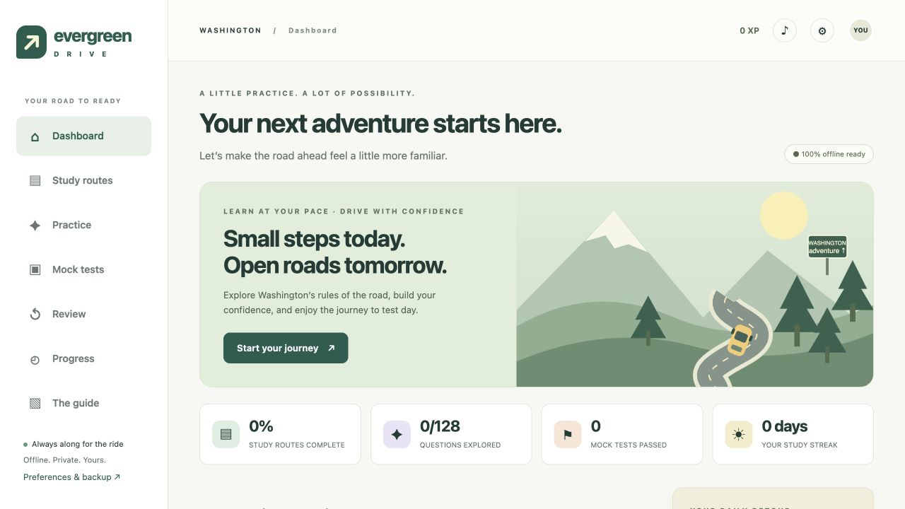
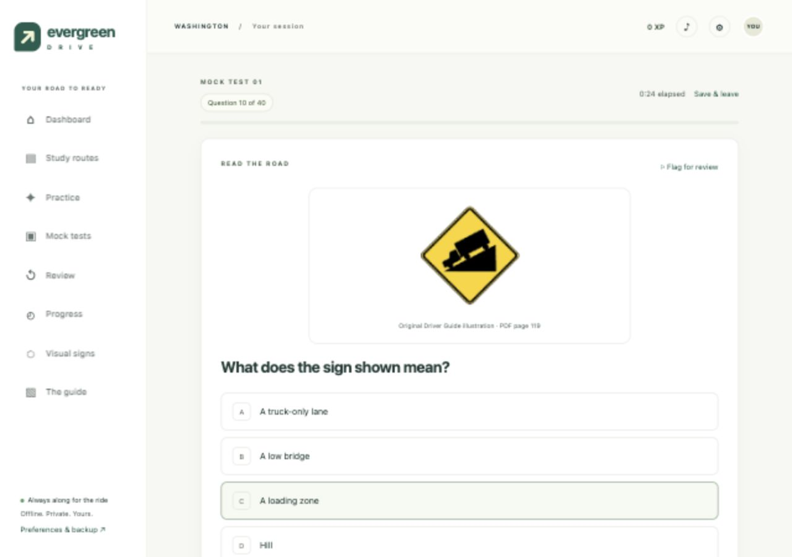

# Evergreen Drive

A colorful, offline study companion for the **Washington state driving knowledge test**. Download the app, open an HTML file, and start learning—no installation, account, or server required.



## Download and open

1. Click the green **Code** button above, then **Download ZIP**.
2. Extract the ZIP completely.
3. Open **index.html** in the extracted folder using your desktop browser.
4. Start a study route, practice a topic, or take a mock test.

You can also open `Evergreen-Drive/index.html` directly. Keep its neighboring files and `assets` folder together. The whole app works offline; only links to external official websites need internet.

## What's included

- **12 study routes** with 155 bite-sized, source-linked lessons.
- **155 original practice questions**, each with an explanation and the supporting PDF page.
- **20 distinct numbered mock tests**: 40 questions each, with a passing threshold of 32/40 (80%).
- Topic practice, daily-five challenges, flashcards, saved questions, and mistake review.
- Spaced recall, progress tracking, study streaks, XP, and milestones.
- Saved test sessions, question flags, navigation, and complete answer reviews.
- An illustrated sign atlas using the official guide's original pages.
- The complete **191-page official guide** and searchable offline text.
- Optional sound effects, reduced motion, keyboard controls, and progress backup/restore.

Each mock has 40 unique questions and covers all 12 routes. The 20 forms are different combinations from the shared 155-question bank, so questions recur across forms. Answer choices are shuffled on each attempt. These are original practice questions, not actual DOL exam items.

## Visual learning

Open **Visual signs** from the sidebar for 27 illustrated cards, a visual practice deck, and visual flashcards. Official sign and lane-marking crops also appear in relevant lessons, questions, and answer reviews. Every newly started mock form includes at least six visual questions; existing saved sessions retain their original question lists.

The 29 core question illustrations are embedded in `content.js`, so they load offline without separate image paths. The full-page sign atlas remains available under **Visual signs → Full guide pages**.



## Sources

Learning content is based exclusively on the supplied [Washington Driver Guide](https://dol.wa.gov/media/pdf/4745/driver-guidepdf/download?inline), edition **520-400 (R/4/25)**, downloaded November 9, 2026. An unchanged copy is included under `Evergreen-Drive/assets/` for offline use. The sign atlas reproduces pages from that guide.

Only the mock-test length and passing score use a second source: the [official Washington DOL testing page](https://dol.wa.gov/driver-licenses-and-permits/driver-training-and-testing/do-i-need-take-test), which specifies 40 multiple-choice questions and 32 correct answers to pass.

The app is independent and is not affiliated with or endorsed by Washington DOL. Topic balance, the interface, XP, badges, and review scheduling are app features, not official test rules. No official time limit is asserted. The timer simply shows elapsed time, including time away from a saved session.

The full guide contains additional context, illustrations, and exceptions. Read it as part of your preparation. Practice results do not guarantee an official exam result. The app reflects the included edition and does not automatically update laws or content.

## Progress and privacy

Progress stays in your browser's local storage. No accounts, analytics, or network APIs are used. Progress is not written into the app folder and is not included when you share the app.

Use **Preferences → Export backup** before changing browsers, moving the folder, or clearing browser data. Restore a backup through **Preferences → Import backup**. Private browsing and browser settings can affect storage persistence, particularly for local files.

## Browser support and verification

Use a current desktop Chrome, Edge, Firefox, or Safari with JavaScript enabled. The implementation uses ordinary scripts and relative local assets; it has no framework, package installation, `fetch`, module-loader, service-worker, or server dependency.

Functional and visual checks were performed in the Codex browser using a local HTTP preview. The testing tool blocks direct `file://` navigation, so double-click behavior has been checked structurally but not automated in a browser. Separate cross-browser certification has not been performed. See [verification details](docs/VERIFICATION.md).

## Development

The editable app lives in `Evergreen-Drive/`:

- `index.html` — app shell
- `style.css` — responsive design
- `app.js` — study, practice, testing, and local progress
- `content.js` — guide-grounded content and searchable source text
- `assets/` — original official PDF and guide-page images
- `START-HERE.txt` — plain-language opening and sharing instructions
- `manifest.json` — release metadata and SHA-256 hashes

No build step is needed. To run the logic checks with Node.js:

```sh
node tests/test_app.cjs
```

The checks cover all 20 test forms, question uniqueness and topic coverage, the 32/40 scoring boundary, unanswered questions, repeat submissions, persistence, review scheduling, and source-reference bounds.

The official guide and its reproduced pages are third-party materials credited to the Washington State Department of Licensing. Their inclusion does not imply ownership or endorsement.

Illustration extraction can be reproduced with `python3 scripts/add_visuals.py` (developer-only dependencies: Pillow and Poppler). The app itself needs neither. Crops preserve official artwork and exclude the guide’s answer captions.
